<p align="center">
  <a href="https://githug.ai"></a>
</p>

<p align="center">
  <b>Give every AI coding agent its own name on GitHub, and a human who answers for it.</b>
</p>

<p align="center">
  <a href="https://github.com/githug-ai/githug/actions/workflows/ci.yml"></a>
  <a href="LICENSE"></a>
  <a href="https://githug.ai/v"></a>
  <a href="https://github.com/githug-ai/githug/pkgs/container/githug"></a>
</p>

<p align="center">
  <a href="https://githug.ai">githug.ai</a> ·
  <a href="https://githug.ai/docs">Docs</a> ·
  <a href="docs/SELF_HOSTING.md">Self-host</a> ·
  <a href="docs/ATTRIBUTION.md">Attribution model</a> ·
  <a href="https://github.com/githug-ai/hug">hug CLI</a> ·
  <a href="https://github.com/githug-ai/verify">verify Action</a>
</p>

<br>

githug turns one GitHub App into many agent identities. Each agent gets a key; the key
buys 1-hour tokens for one repo; every push is logged and checkable by anyone.

```
agent key ──▶ POST /v1/token ──▶ 1-hour token, one repo, least privilege
   │                                   │
   │                         git push as  orbit <orbit@agents.example.com>
   │                         Accountable: ana · Agent: orbit · Run: loop-42
   ▼
hug pre-push ──▶ POST /v1/commits ──▶ /v/<owner>/<repo>/<sha>: ✓ verified
```

- **Per-agent identity.** Commits and PRs say which agent made them, optionally under the
  agent's own GitHub App (its own avatar and rate limits).
- **Short-lived, scoped tokens.** No PATs in agent sandboxes; keys rotate and revoke per agent.
- **Proof, not claims.** The agent's key attests what it pushed; a public verify page and a
  GitHub Action check any commit or PR against the registry and key log.

Hosted at **[githug.ai](https://githug.ai)**, or run it yourself:
[one container or your own Cloudflare account](docs/SELF_HOSTING.md).

## Quick start (hosted)

```sh
curl -fsSL https://githug.ai/install | sh   # the hug CLI
hug init --repo owner/repo                  # approve one code on github.com
hug setup                                   # in your clone: git push now acts as the agent
```

Agent docs: [githug.ai/docs](https://githug.ai/docs). The CLI is
[githug-ai/hug](https://github.com/githug-ai/hug) and the PR check is
[githug-ai/verify](https://github.com/githug-ai/verify) (both Apache-2.0).

## Self-host

```sh
docker run -p 8080:8080 -v githug:/data -e GITHUG_ORIGIN=https://githug.example.com ghcr.io/githug-ai/githug
```

Then open `/gateway/setup/github-app` to create your instance's GitHub App in one click.
Everything is included: no billing, no limits, single-tenant. Full guide:
[docs/SELF_HOSTING.md](docs/SELF_HOSTING.md).

## How it's built

One TypeScript app ([Hono](https://hono.dev)), dependency-light, server-rendered pages. It
runs on Cloudflare Workers (D1, KV, R2, rate limits, cron) or on Node with the same code:
`src/node/bindings.ts` provides those bindings over SQLite and the filesystem.

| Path | What it is |
|---|---|
| `src/core.ts` · `src/worker.ts` | All routes: API (`/v1/*`), dashboard (`/app`), sign-in, verify pages, docs, cron · the Worker entry |
| `src/gateway-api.ts` | Agents, keys, token minting, accounts and orgs, verify, attestations |
| `src/site.ts` · `src/instance.ts` | Instance config (origin, agent domain, mode) · self-host setup and signup list |
| `src/app.ts` · `src/verify.ts` · `src/docs.ts` | Dashboard, verify and docs pages |
| `src/node/` | Node host for the container: bindings + HTTP server + cron loop |
| `migrations/` | D1/SQLite schema (applied by wrangler, or by the container on start) |
| `content/docs/` | Agent quickstarts, served at `/docs` |
| `test/` | `node:test` suite: the real Worker on Node bindings, GitHub faked at `fetch` |

This repository is the service. githug.ai runs it unchanged, with its own website (landing,
blog, reference pages) in front; those aren't part of the open-source core.

## Develop

```sh
npm ci
npm test              # node:test, no network
npm run typecheck
npm run cf:migrate:local && npm run cf:dev   # Workers runtime (wrangler dev), needs .dev.vars
npm run build:node && GITHUG_DATA=./data PORT=8080 npm run start:node   # the container's entry
```

`.dev.vars.example` lists the Worker's variables. GitHub App values for local dev come from
the setup page (saved to your local D1) or from `.dev.vars`.

## Contributing

Issues and PRs welcome: see [CONTRIBUTING.md](CONTRIBUTING.md) (small CLA on your first PR).
Security reports: [SECURITY.md](SECURITY.md), privately please.

## License

[AGPL-3.0](LICENSE). Run it, change it, host it; if you offer a modified githug as a service,
publish your changes. The `hug` CLI and the verify Action are Apache-2.0.
